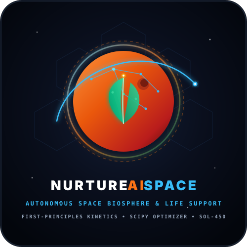

  
  <h1>NURTUREAISPACE</h1>
  
<em>Autonomous Space Nutrition, Thermodynamic Degradation Kinetics & Life Support Optimization System</em>

  

    
    
    
  

---

### 👥 Team NurtureAISpace
* **Suleyman Hajizadeh** — Lead Systems Architect & Research ([`suleyman.hacizade1@gmail.com`](mailto:suleyman.hacizade1@gmail.com))
* **Banu Gurbanizada** — Frontend Architecture & UI/UX Design ([`banugurbanzade@gmail.com`](mailto:banugurbanzade@gmail.com))
* **Yunis** — AI/ML & Degradation Modeling ([`allahverdiyunis@gmail.com`](mailto:allahverdiyunis@gmail.com))
* **Faruk Karimli** — Computer Engineering & Life Support Simulation ([`fkarimli23291@ada.edu.az`](mailto:fkarimli23291@ada.edu.az))

---

### 🚀 Executive Overview

On a long-duration human mission to Mars (such as the target **Sol-450** milestone), astronauts cannot rely on Earth resupply. The greatest danger is not merely caloric starvation — it is **invisible micronutrient degradation**. Critical vitamins such as Thiamine (B1) and Ascorbic Acid (Vitamin C) break down continuously over multi-year storage according to **Arrhenius chemical kinetics**. A minor refrigeration breakdown can trigger early cognitive decline or beriberi while calories appear abundant.

**NurtureAISpace** is an autonomous mission-grade system that integrates:
- **First-Principles Chemical Thermodynamics:** Non-linear Arrhenius degradation kinetics calibrated against empirical spaceflight food stability datasets ($R^2 \ge 0.99$).
- **SciPy Linear Optimization:** Solves constrained daily astronaut meal composition to satisfy NASA-STD-3001 requirements while minimizing payload launch mass and refrigeration power draw.
- **Dynamic Sol-450 Mission Simulator:** Sol-by-Sol habitat simulation with injectable subsystem failures (cooling loop breakdown, crop pathogen blight) and real-time hazard logging.
- **Bio-regenerative Life Support (BLSS):** Models closed-loop Spirulina photobioreactors, hydroponic vertical microgreens, aeroponic cherry tomatoes, and dwarf sweet potatoes.

---

### 🌐 Live Public Demonstration Platform

The interactive web portal is deployed and running live on GitHub Pages with zero server lag:

👉 **[https://nurtureaispace.github.io/](https://nurtureaispace.github.io/)**

Visitors and researchers can interact with:
1. **Executive Sol-450 Mission Dashboard:** Timeline scrubber, Food Security Index gauge, crop harvest yield, and cooling load.
2. **Data Laboratory:** Curated space food catalogs and empirical benchmark validation comparisons ($R^2 = 0.999$, $\text{RMSE} < 0.35\%$).
3. **Arrhenius Kinetics Engine:** Real-time temperature slider ($-20^\circ\text{C}$ to $+38^\circ\text{C}$), reactive SVG exponential decay curves, and Drop-Dead Sol calculations.
4. **SciPy Diet Optimizer:** Multi-objective meal plan solver under crew size, water, and biomass constraints.
5. **Mission Stress-Test Simulator:** Sol 150 cooling loop malfunction injection, survival verdicts, and hazard logging.

---

### 🔒 Core Codebase & Intellectual Property Notice

> [!IMPORTANT]
> To safeguard our research, specialized kinetic calibration algorithms, and proprietary optimization pipelines, the core production codebase is hosted in a **Private Repository**:
>
> 📁 **Repository:** [`NurtureAISpace/mars-food-intelligence`](https://github.com/NurtureAISpace/mars-food-intelligence) *(Private)*
>
> **Stack:** Python 3.12, FastAPI, SciPy, NumPy, Pandas, Scikit-learn, React 18, TypeScript, Tailwind CSS, Docker, Pytest (16/16 automated tests passing).

#### ✉️ Code Access Policy for Reviewers & Evaluators
Evaluators, mentors, scientific reviewers, and accredited evaluators who require code review or test suite inspection can request access by contacting the project lead:

* **Lead Researcher & Architect:** Suleyman Hajizadeh  
* **Email:** [`suleyman.hacizade1@gmail.com`](mailto:suleyman.hacizade1@gmail.com)  

---

  Developed by Team NurtureAISpace • © 2026 NurtureAISpace

