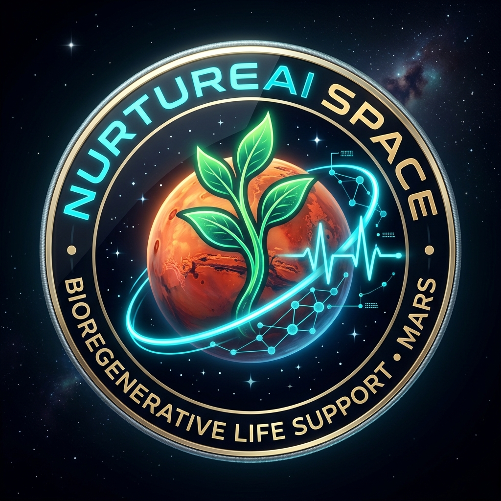

# NurtureAI Space

  
   
  <h2>NurtureAI Space: Health Monitoring for Astronauts</h2>
  
NASA Space Apps Challenge 2026: <em>Create Health Monitoring Software for Astronauts on Space Missions</em>. Personal baseline health monitoring, storage vitamin degradation kinetics, and bio-nutritional meal optimization.

  

    <a href="https://nurtureaispace.github.io">Live Demo</a> | 
    <a href="https://nurtureaispace.github.io/app/">Astronaut Application</a> | 
    <a href="https://nurtureaispace.github.io/slides.html">Slide Deck</a> | 
    <a href="certificates/NASA_Space_Apps_Challenge_2026_Certificate.pdf">NASA Certificate</a>
  

---

## Team

- **Suleyman Hajizadeh** - Lead Systems Architect and Research (`suleyman.hacizade1@gmail.com`)
- **Banu Gurbanzada** - Frontend Architecture and UI/UX Design (`banugurbanzade@gmail.com`)
- **Yunis Allahverdi** - AI/ML and Degradation Modeling (`allahverdiyunis@gmail.com`)
- **Faruk Karimli** - Computer Engineering and Life Support Simulation (`fkarimli23291@ada.edu.az`)

---

## Live Platform and Repositories

- **Crew Dashboard:** https://nurtureaispace.github.io
- **Astronaut App (Offline-First Daily Check-In):** https://nurtureaispace.github.io/app/
- **Slide Deck:** https://nurtureaispace.github.io/slides.html
- **Source Code Repository:** https://github.com/NurtureAISpace/mars-food-intelligence
- **Static Deployment Repository:** https://github.com/NurtureAISpace/NurtureAISpace.github.io
- **Official NASA Certificate (Galactic Problem Solver):** [Certificate PDF](certificates/NASA_Space_Apps_Challenge_2026_Certificate.pdf) | [Credential Dossier](https://suleimancertificates.github.io/certificates/nasa-space-apps-challenge-2026/)

---

## Technical Overview

- **NASA Evidence and Personal Baseline:** Uses NASA Open Science Data Repository (OSDR) Inspiration4 datasets (OSD-569 and OSD-575) to compare each crew member against their pre-flight individual baseline rather than broad population ranges.
- **Degradation Kinetics:** Models thermal degradation of labile micronutrients (Vitamin C and Thiamine B1) in stored food rations across mission storage temperatures using Arrhenius kinetics.
- **Linear Meal Optimization:** Solves constrained daily meal compositions using SciPy HiGHS linear programming to balance stored rations with fresh greenhouse crops (microgreens, cherry tomatoes) against nutritional requirements, payload mass, and power constraints.
- **Offline-First Architecture:** The astronaut check-in application functions fully offline via client-side IndexedDB storage with pseudonymized crew identifiers and zero runtime server dependency.

---

## Data Sources and Notes

This project is a research prototype developed for the NASA Space Apps Challenge 2026 in Ganja.
- Real NASA data used: NASA OSDR datasets OSD-569 and OSD-575 (Inspiration4). NASA publications and exploration nutrition requirements are cited as scientific references.
- Parameter provenance: Parameters and literature references are documented in `docs/DATA_SOURCES.md` in the `mars-food-intelligence` repository.
- Development timeline: Transparently documented in the `mars-food-intelligence` README.
